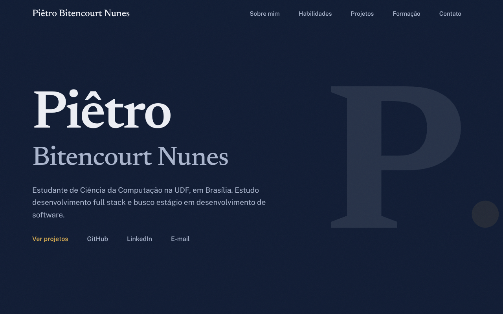
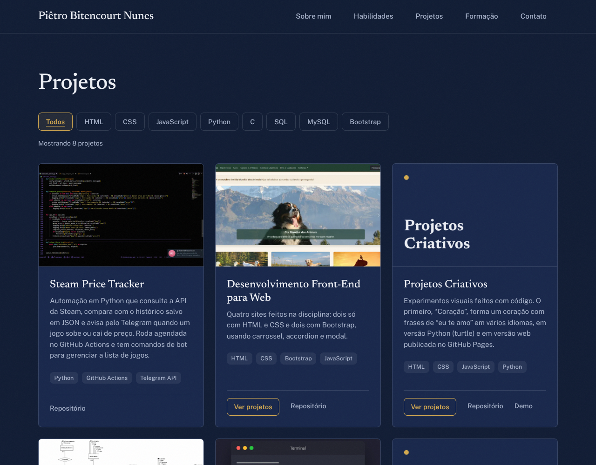
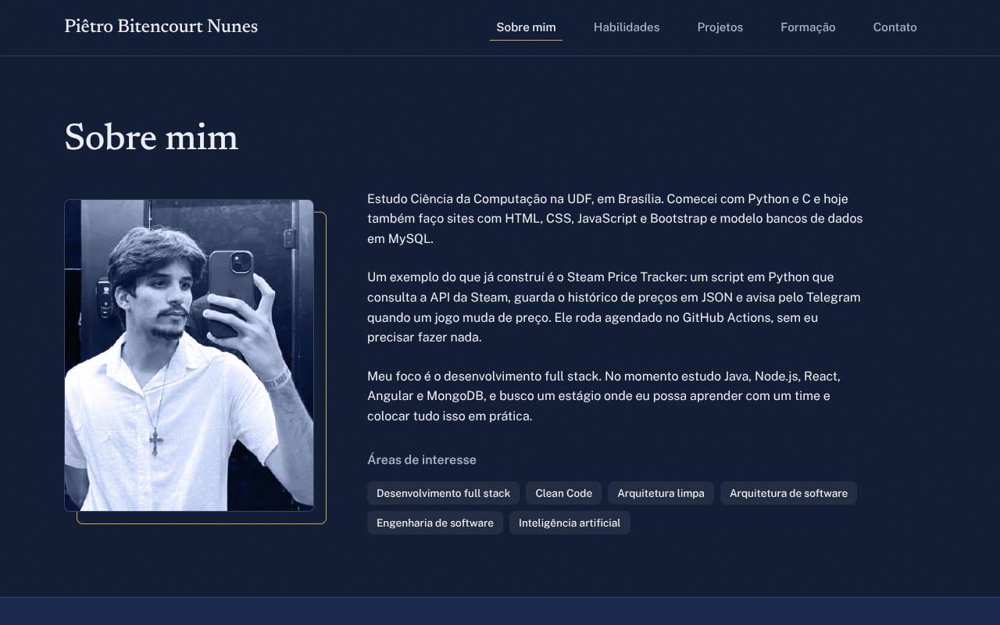
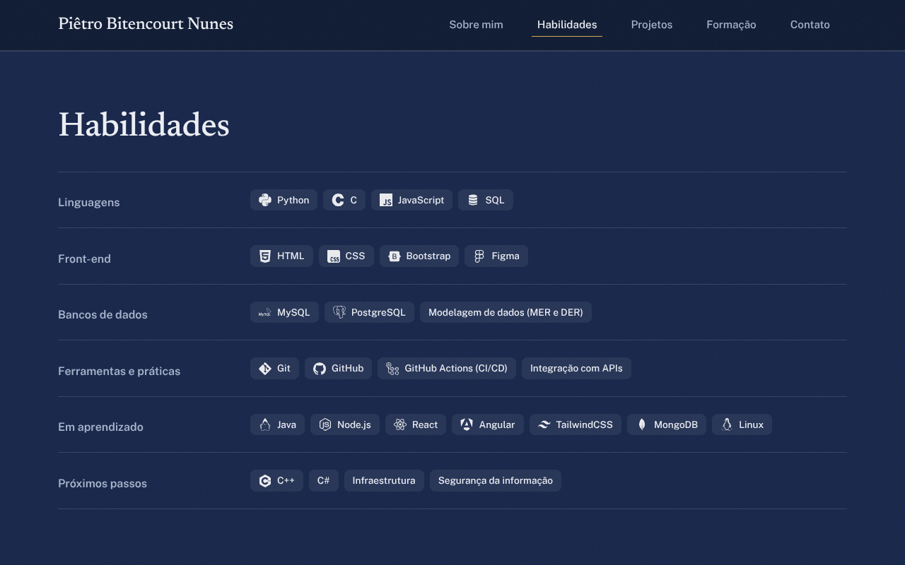
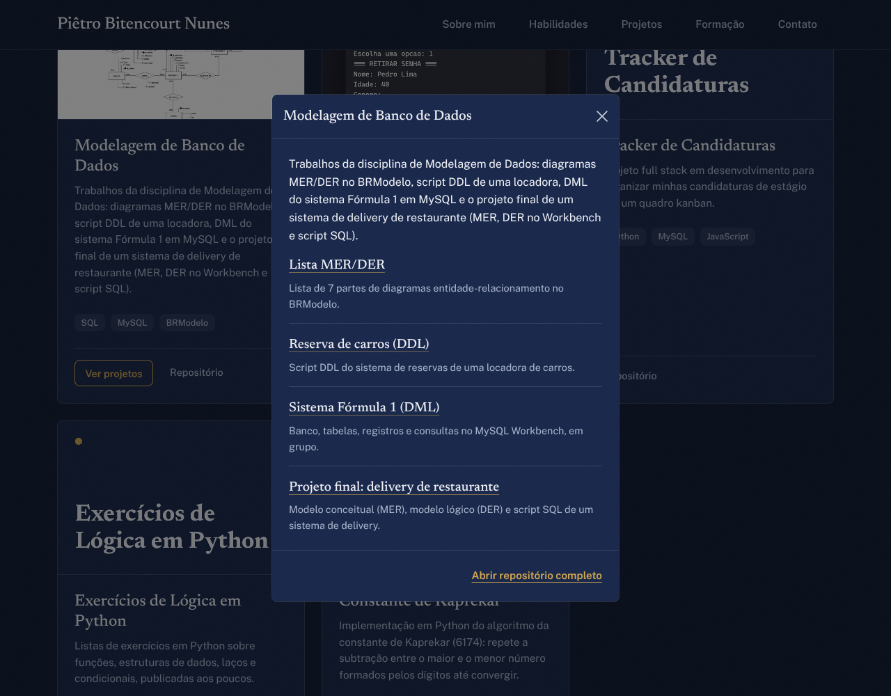
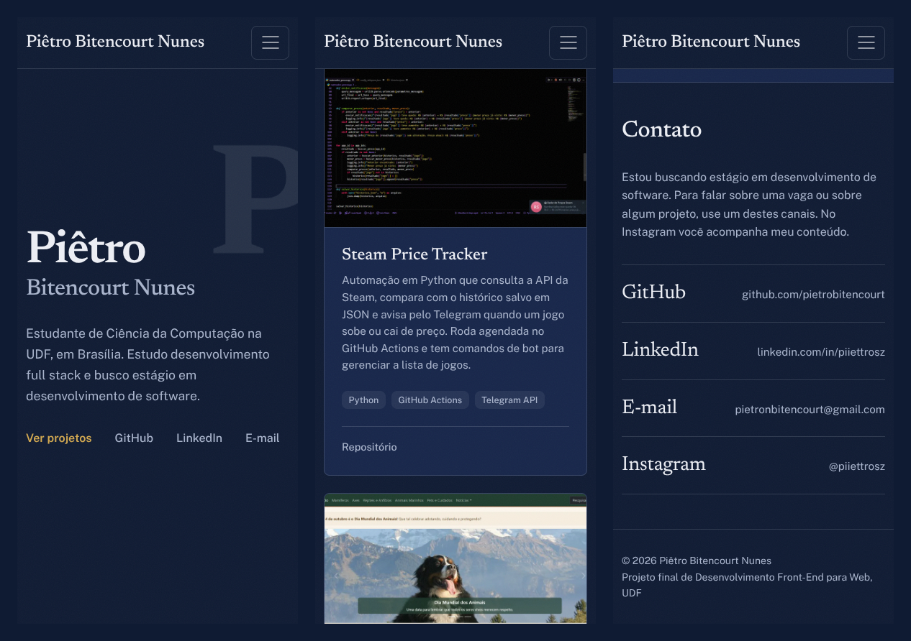

<div align="center">

# Portfólio Pessoal · Personal Portfolio

**Piêtro Bitencourt Nunes**


[](https://pietrobitencourt.github.io/front-end-web-development/05-portfolio/)

[Português](#português) · [English](#english)

</div>

---

## Prévia · Preview





<details>
<summary>Mais capturas de tela · More screenshots</summary>

<br>

**Sobre mim · About me**



**Habilidades · Skills**



**Modal de subprojetos · Subprojects modal**



**Celular · Mobile**



</details>

---

## Português

### Sobre o projeto

Site de portfólio pessoal desenvolvido como **projeto final** da disciplina de Desenvolvimento Front-End para Web. Ele apresenta quem eu sou, o que estudo, minhas habilidades, meus projetos publicados no GitHub, minha formação, meus certificados e meus contatos.

O site foi feito apenas com **HTML, CSS e JavaScript**, com o **Bootstrap** para grade, menu e modal. Não usa framework de JavaScript nem etapa de compilação.

### Demonstração

**https://pietrobitencourt.github.io/front-end-web-development/05-portfolio/**

### Funcionalidades

- **Design responsivo**, pensado primeiro para celular, com menu "hambúrguer" que fecha sozinho ao escolher uma seção.
- **Cards de projetos gerados por JavaScript** a partir de uma lista de dados (`js/projetos.js`): para adicionar um projeto, basta incluir um objeto na lista.
- **Filtro por tecnologia** (HTML, CSS, JavaScript, Python, C, SQL, MySQL, Bootstrap), com contagem anunciada para leitores de tela.
- **Modal com os subprojetos** de cada repositório, cada um com link próprio, além do link para o repositório completo.
- **Menu que acompanha a rolagem** (ScrollSpy do Bootstrap) e rolagem suave entre as seções.
- **Habilidades com ícones** das tecnologias, em SVG local (sem depender de serviços externos).
- **Acessibilidade:** HTML semântico, link "Pular para o conteúdo", foco visível no teclado, textos alternativos, atributos `aria-pressed` e `aria-live`, respeito à preferência por menos movimento e contraste de texto acima de 7:1 nas combinações principais.
- **Desempenho:** capas dos projetos em WebP, carregamento preguiçoso (`loading="lazy"`) e fontes limitadas aos pesos usados.

### Tecnologias

| Tecnologia | Uso no projeto |
|---|---|
| HTML5 | Estrutura semântica (`header`, `nav`, `main`, `section`, `footer`) |
| CSS3 | Variáveis (`:root`), Flexbox, Grid, `clamp()`, transições e media queries |
| JavaScript (ES6) | Manipulação do DOM, *template literals*, `map`/`filter`/`find`, delegação de eventos |
| Bootstrap 5.3 | Grade, navbar, collapse, modal e ScrollSpy |
| Google Fonts | Newsreader (títulos) e Public Sans (texto) |
| Simple Icons | Ícones das tecnologias (SVG) |
| GitHub Pages | Hospedagem |

### Estrutura do projeto

```
05-portfolio/
├── index.html
├── README.md
├── css/
│   └── style.css            # tema, layout e componentes
├── js/
│   ├── projetos.js          # dados dos projetos (lista de objetos)
│   └── main.js              # cards, filtro, modal, menu e ScrollSpy
├── img/
│   ├── favicon.svg / .png   # ícone do site
│   ├── perfil.jpg           # foto de perfil
│   ├── icons/               # ícones das tecnologias (SVG)
│   └── projetos/            # capas dos projetos (16:10)
└── docs/
    ├── certificado-*.pdf    # certificados
    └── screenshots/         # capturas de tela usadas neste README
```

### Como executar

Não há dependências para instalar.

```bash
git clone https://github.com/pietrobitencourt/front-end-web-development.git
cd front-end-web-development/05-portfolio
```

Abra o `index.html` no navegador. Se preferir, use a extensão **Live Server** do VS Code. É necessária conexão com a internet para carregar o Bootstrap e as fontes (via CDN).

### Como adicionar um projeto

Edite `js/projetos.js` e inclua um objeto na lista `projetos`:

```js
{
  id: "meu-projeto",
  nome: "Meu Projeto",
  descricao: "Uma ou duas frases sobre o que ele faz.",
  tecnologias: ["Python", "MySQL"],        // use os mesmos nomes dos botões de filtro
  imagem: "img/projetos/meu-projeto.webp", // capa em 16:10
  imagemAlt: "Descrição da capa",
  repositorio: "https://github.com/usuario/meu-projeto",
  demo: "",                                // link do site publicado, se houver
  subprojetos: []                          // { nome, link, descricao, demo }
}
```

### Requisitos da disciplina

| Requisito | Como foi atendido |
|---|---|
| Site de portfólio (sobre mim, o que faço ou hobby) | Apresentação, sobre mim, habilidades, projetos, formação e contato |
| Hospedagem no GitHub Pages | Publicado na pasta `05-portfolio` deste repositório |
| Conteúdo em HTML, CSS e JavaScript | `index.html`, `css/style.css`, `js/main.js` e `js/projetos.js` |
| Design responsivo (celular) | Layout mobile first, grade do Bootstrap e media queries |
| Arquitetura com pastas separadas | `css/`, `js/`, `img/` e `docs/` separados, com o HTML na raiz |

### Créditos e direitos de imagem

- A foto de perfil é minha.
- As capas dos projetos são capturas de tela dos meus próprios trabalhos. As imagens de terceiros que aparecem nelas (obtidas no Pixabay e no Pinterest) pertencem aos seus respectivos autores e são exibidas apenas para fins educacionais e de demonstração.
- Os certificados pertencem à MongoDB, Inc., que os emitiu.
- Fontes: Newsreader e Public Sans, sob a SIL Open Font License, via Google Fonts.
- Bootstrap: licença MIT.
- Ícones: [Simple Icons](https://simpleicons.org/), licença CC0 1.0. Os logotipos são marcas registradas de seus respectivos proprietários.

### Contexto acadêmico

Projeto final da disciplina **Desenvolvimento Front-End para Web**, do **Centro Universitário do Distrito Federal (UDF)**, sob orientação do professor **Eliel Silva da Cruz**, em 2026.

### Autor

**Piêtro Bitencourt Nunes**, estudante de Ciência da Computação na UDF.

[](https://github.com/pietrobitencourt)
[](https://www.linkedin.com/in/piiettrosz/)

[Voltar ao topo](#portfólio-pessoal--personal-portfolio)

---

## English

### About the project

Personal portfolio website built as the **final project** of the Front-End Web Development course. It presents who I am, what I am studying, my skills, my projects published on GitHub, my education, my certificates and my contact details.

The site uses only **HTML, CSS and JavaScript**, with **Bootstrap** for the grid, navigation bar and modal. It has no JavaScript framework and no build step.

### Live demo

**https://pietrobitencourt.github.io/front-end-web-development/05-portfolio/**

### Features

- **Responsive design**, mobile first, with a hamburger menu that closes by itself when a section is chosen.
- **Project cards generated by JavaScript** from a data list (`js/projetos.js`): to add a project, just add an object to the list.
- **Filter by technology** (HTML, CSS, JavaScript, Python, C, SQL, MySQL, Bootstrap), with the result count announced to screen readers.
- **Modal listing the subprojects** of each repository, each with its own link, plus a link to the full repository.
- **Navigation that follows scrolling** (Bootstrap ScrollSpy) and smooth scrolling between sections.
- **Skills with technology icons**, as local SVG files (no external services).
- **Accessibility:** semantic HTML, "Skip to content" link, visible keyboard focus, alternative texts, `aria-pressed` and `aria-live` attributes, support for the reduced-motion preference, and text contrast above 7:1 in the main combinations.
- **Performance:** WebP project covers, lazy loading (`loading="lazy"`) and fonts limited to the weights in use.

### Technologies

| Technology | Use in the project |
|---|---|
| HTML5 | Semantic structure (`header`, `nav`, `main`, `section`, `footer`) |
| CSS3 | Custom properties (`:root`), Flexbox, Grid, `clamp()`, transitions and media queries |
| JavaScript (ES6) | DOM manipulation, template literals, `map`/`filter`/`find`, event delegation |
| Bootstrap 5.3 | Grid, navbar, collapse, modal and ScrollSpy |
| Google Fonts | Newsreader (headings) and Public Sans (body text) |
| Simple Icons | Technology icons (SVG) |
| GitHub Pages | Hosting |

### Project structure

```
05-portfolio/
├── index.html
├── README.md
├── css/
│   └── style.css            # theme, layout and components
├── js/
│   ├── projetos.js          # project data (list of objects)
│   └── main.js              # cards, filter, modal, menu and ScrollSpy
├── img/
│   ├── favicon.svg / .png   # site icon
│   ├── perfil.jpg           # profile photo
│   ├── icons/               # technology icons (SVG)
│   └── projetos/            # project covers (16:10)
└── docs/
    ├── certificado-*.pdf    # certificates
    └── screenshots/         # screenshots used in this README
```

### How to run

There are no dependencies to install.

```bash
git clone https://github.com/pietrobitencourt/front-end-web-development.git
cd front-end-web-development/05-portfolio
```

Open `index.html` in your browser, or use the VS Code **Live Server** extension. An internet connection is needed to load Bootstrap and the fonts (via CDN).

### How to add a project

Edit `js/projetos.js` and add an object to the `projetos` list:

```js
{
  id: "my-project",
  nome: "My Project",
  descricao: "One or two sentences about what it does.",
  tecnologias: ["Python", "MySQL"],       // use the same names as the filter buttons
  imagem: "img/projetos/my-project.webp", // 16:10 cover
  imagemAlt: "Cover description",
  repositorio: "https://github.com/user/my-project",
  demo: "",                               // published site link, if any
  subprojetos: []                         // { nome, link, descricao, demo }
}
```

### Course requirements

| Requirement | How it was met |
|---|---|
| Portfolio website (about me, what I do or a hobby) | Home, about me, skills, projects, education and contact |
| Hosting on GitHub Pages | Published from the `05-portfolio` folder of this repository |
| HTML, CSS and JavaScript content | `index.html`, `css/style.css`, `js/main.js` and `js/projetos.js` |
| Responsive (mobile) design | Mobile-first layout, Bootstrap grid and media queries |
| Architecture with separate folders | `css/`, `js/`, `img/` and `docs/` kept separate, with the HTML at the root |

### Credits and image rights

- The profile photo is mine.
- The project covers are screenshots of my own work. Third-party images that appear in them (taken from Pixabay and Pinterest) belong to their respective authors and are shown for educational and demonstration purposes only.
- The certificates belong to MongoDB, Inc., which issued them.
- Fonts: Newsreader and Public Sans, under the SIL Open Font License, via Google Fonts.
- Bootstrap: MIT license.
- Icons: [Simple Icons](https://simpleicons.org/), CC0 1.0 license. Logos are trademarks of their respective owners.

### Academic context

Final project of the **Front-End Web Development** course at the **Centro Universitário do Distrito Federal (UDF)**, supervised by Professor **Eliel Silva da Cruz**, 2026.

### Author

**Piêtro Bitencourt Nunes**, Computer Science student at UDF.

[](https://github.com/pietrobitencourt)
[](https://www.linkedin.com/in/piiettrosz/)

[Back to top](#portfólio-pessoal--personal-portfolio)