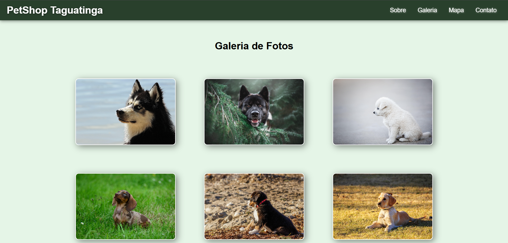
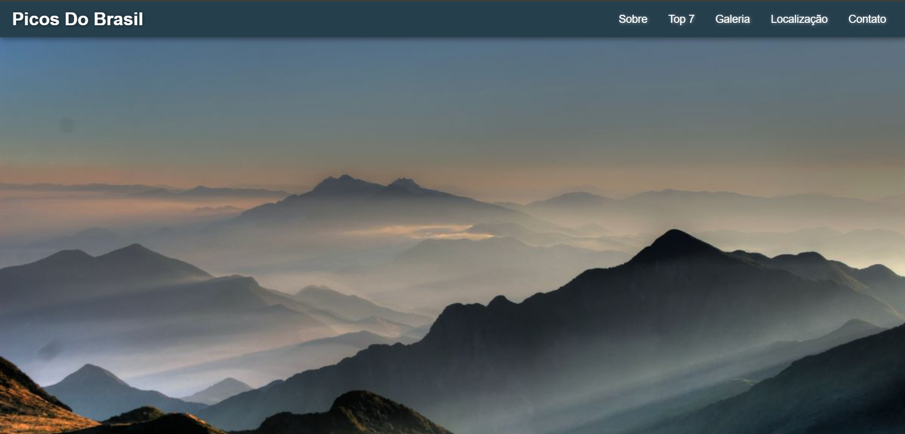
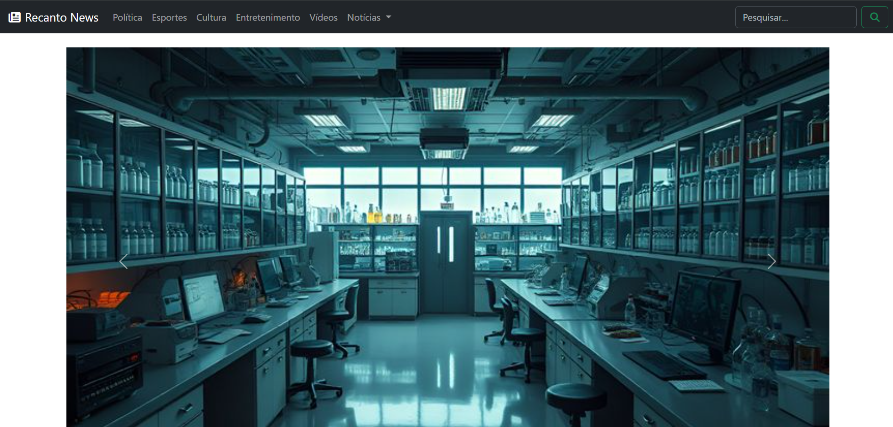
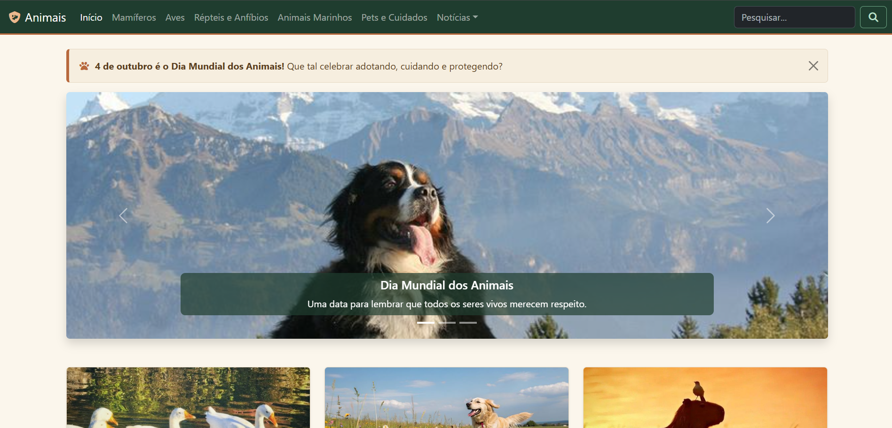
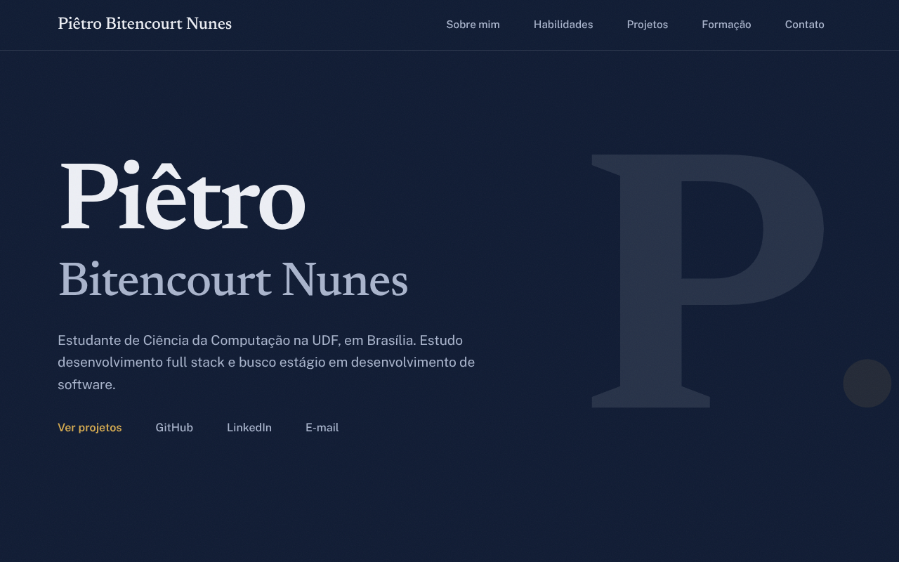

<div align="center">

# Front-End Web Development

**Atividades da disciplina de Desenvolvimento Front-End para Web**
**Coursework from the Front-End Web Development class**


<!--
Descomente os badges abaixo conforme as tecnologias forem sendo usadas:


-->


[Português (BR)](#pt-br) · [English](#en)

</div>

<p align="center">
  <a href="./01-petshop-taguatinga"></a>
  <a href="./02-picos-do-brasil"></a>
  <a href="./03-recanto-news"></a>
  <a href="./04-dia-mundial-animais"></a>
  <a href="./05-portfolio"></a>
</p>

---

<a id="pt-br"></a>

## Português (BR)

### Sobre o repositório

Este repositório reúne as atividades práticas que desenvolvo na disciplina de **Desenvolvimento Front-End para Web**. Cada atividade fica em uma pasta própria, numerada na ordem em que foi feita, com seu próprio README e seus prints, e pode ser aberta direto no navegador, sem etapa de build.

O objetivo é documentar minha evolução, desde HTML e CSS puros até o uso de bibliotecas e novas ferramentas, mantendo cada projeto organizado e fácil de executar. O repositório continua crescendo: novas atividades entram em pastas numeradas (`06-...`, `07-...`) conforme a disciplina avança.

### Contexto acadêmico

| | |
|---|---|
| **Instituição** | Centro Universitário do Distrito Federal (UDF), Brasília - DF |
| **Curso** | Ciência da Computação |
| **Disciplina** | Desenvolvimento Front-End para Web |
| **Professor** | Eliel Silva da Cruz |

### Atividades

| # | Projeto | Descrição | Tecnologias | Demo | Código |
|---|---------|-----------|-------------|------|--------|
| 01 | **PetShop Taguatinga** | Site institucional de uma página só: header fixo com navegação por âncoras, seção hero, galeria de fotos com efeito hover, mapa do Google incorporado e formulário de contato. | HTML5, CSS3 (Flexbox) | [Ver demo](https://pietrobitencourt.github.io/front-end-web-development/01-petshop-taguatinga/) | [Abrir pasta](./01-petshop-taguatinga) |
| 02 | **Picos do Brasil** | Prática Avaliativa 1. Site sobre os 7 picos mais altos do Brasil, com novo item de menu e nova seção "Top 7" (altitude, localização e curiosidades de cada pico), galeria de fotos, mapa incorporado e novo tema de cores. | HTML5, CSS3 (Flexbox) | [Ver demo](https://pietrobitencourt.github.io/front-end-web-development/02-picos-do-brasil/) | [Abrir pasta](./02-picos-do-brasil) |
| 03 | **Recanto News** | Atividade em sala de introdução ao Bootstrap. Portal de notícias com tema de ciência: navbar responsiva com dropdown, carrossel, cards, accordion e layout em grid. | HTML5, Bootstrap 5, Font Awesome | [Ver demo](https://pietrobitencourt.github.io/front-end-web-development/03-recanto-news/) | [Abrir pasta](./03-recanto-news) |
| 04 | **Dia Mundial dos Animais** | Prática Avaliativa 2, feita em dupla com [Zamorano Fragoso de Sousa](https://github.com/zamfs). Site sobre o Dia Mundial dos Animais (4 de outubro) com 10 componentes do Bootstrap: navbar com dropdown, carrossel, cards, accordion, alert, modal, toast, list group e badge. Paleta própria em variáveis CSS. | HTML5, CSS3, Bootstrap 5, JavaScript, Font Awesome | [Ver demo](https://pietrobitencourt.github.io/front-end-web-development/04-dia-mundial-animais/) | [Abrir pasta](./04-dia-mundial-animais) |
| 05 | **Portfólio Pessoal** | Projeto final. Site de portfólio responsivo com apresentação, habilidades com ícones, projetos em cards gerados por JavaScript (com filtro por tecnologia e modal de subprojetos), formação, certificados e contatos. | HTML5, CSS3, JavaScript, Bootstrap 5 | [Ver demo](https://pietrobitencourt.github.io/front-end-web-development/05-portfolio/) | [Abrir pasta](./05-portfolio) |

### O que cada atividade pratica

**01 · PetShop Taguatinga**
- Estrutura semântica com `header`, `nav`, `main`, `section` e `footer`
- Layout com Flexbox e unidades relativas (`rem`, `vh`)
- Header fixo, navegação por âncoras e transições (`transition`, `transform`) em hover
- Imagens com `object-fit`, mapa incorporado via `iframe` e formulário de contato

**02 · Picos do Brasil**
- Evolução do projeto 01: novo item de menu, nova seção e troca completa da paleta de cores
- Conteúdo sobre o Brasil organizado em colunas (Flexbox), com altitude e localização de cada pico
- Galeria de fotos, mapa do Google My Maps incorporado e formulário de contato

**03 · Recanto News**
- Sistema de grid do Bootstrap (`container`, `row`, `col-lg-*`)
- Componentes: navbar com menu colapsável e dropdown, carrossel, cards e accordion
- Ícones com Font Awesome
- Tema escuro da navbar com `data-bs-theme`

**04 · Dia Mundial dos Animais**
- Dez componentes do Bootstrap: navbar, dropdown, carousel, card, accordion, alert, modal, toast, list group e badge
- Interatividade com JavaScript: toast exibido por botão com `bootstrap.Toast`
- Paleta personalizada com variáveis CSS, sobrescrevendo as variáveis `--bs-*` do Bootstrap
- Navbar fixa (`sticky-top`) com navegação por âncoras e `scroll-margin-top`
- Cards de mesma altura, imagens com `object-fit` e carrosséis com indicadores e legendas
- Acessibilidade: textos `alt` descritivos, `aria-label` e `visually-hidden`

**05 · Portfólio Pessoal**
- Arquitetura com pastas separadas (`css/`, `js/`, `img/`, `docs/`) e design responsivo *mobile first*
- Dados separados da interface: lista de projetos em `projetos.js` e cards gerados com JavaScript (`map`, *template literals*, `innerHTML`)
- Filtro por tecnologia com `filter` e `includes`, usando delegação de eventos
- Modal do Bootstrap preenchido por JavaScript, ScrollSpy e menu colapsável que fecha sozinho
- Variáveis CSS, `clamp()`, Grid e Flexbox, sobrescrevendo as variáveis `--bs-*` do Bootstrap
- Acessibilidade: link para pular o conteúdo, foco visível, `aria-pressed`, `aria-live` e `prefers-reduced-motion`

### Estrutura do repositório

```
front-end-web-development/
├── README.md
├── LICENSE
├── 01-petshop-taguatinga/
│   ├── README.md
│   ├── index.html
│   ├── css/
│   │   └── style.css
│   ├── img/
│   └── docs/
│       └── screenshots/
│           └── capa.png
├── 02-picos-do-brasil/
│   ├── README.md
│   ├── index.html
│   ├── css/
│   │   └── style.css
│   ├── img/
│   └── docs/
│       └── screenshots/
│           └── top-7.png
├── 03-recanto-news/
│   ├── README.md
│   ├── index.html
│   ├── css/
│   │   └── bootstrap.min.css
│   ├── js/
│   │   └── bootstrap.bundle.min.js
│   ├── fontawesome/
│   │   ├── css/all.min.css
│   │   └── webfonts/
│   ├── img/
│   └── docs/
│       └── screenshots/
│           └── capa.png
├── 04-dia-mundial-animais/
│   ├── README.md
│   ├── index.html
│   ├── css/
│   │   └── bootstrap.min.css
│   ├── js/
│   │   └── bootstrap.bundle.min.js
│   ├── fontawesome-free-7.3.1-web/
│   │   ├── css/all.min.css
│   │   └── webfonts/
│   ├── img/
│   └── docs/
│       └── screenshots/
│           ├── 01-inicio.png
│           ├── 02-cards.png
│           ├── 03-lista-accordion.png
│           └── 04-modal-toast.png
└── 05-portfolio/
    ├── README.md
    ├── index.html
    ├── css/
    │   └── style.css
    ├── js/
    │   ├── projetos.js
    │   └── main.js
    ├── img/
    │   ├── icons/
    │   └── projetos/
    └── docs/
        ├── certificado-*.pdf
        └── screenshots/
```

### Como executar

1. Clone o repositório:
   ```bash
   git clone https://github.com/pietrobitencourt/front-end-web-development.git
   ```
2. Entre na pasta da atividade desejada, por exemplo:
   ```bash
   cd front-end-web-development/05-portfolio
   ```
3. Abra o `index.html` no navegador (ou use a extensão **Live Server** do VS Code).

Não é necessário instalar nada: as dependências das atividades 03 e 04 já estão incluídas na pasta do projeto. A atividade 05 carrega o Bootstrap e as fontes por CDN, então precisa de conexão com a internet para aparecer completa.

### Observações

- Os formulários de contato das atividades 01 e 02 são apenas visuais: não há backend, então nenhuma mensagem é enviada.
- A atividade 04 foi desenvolvida em dupla. Veja o README da pasta para os dois autores.
- **Imagens:** as da atividade 01 vêm do [Pixabay](https://pixabay.com/); as das atividades 02, 03 e 04 foram encontradas no Pinterest e pertencem aos seus respectivos autores. Na atividade 05, a foto de perfil é minha e as capas dos projetos são capturas de tela dos meus próprios trabalhos (que incluem as imagens de terceiros citadas acima). Todas são usadas somente para fins educacionais. Se você é o autor de alguma imagem e deseja crédito ou remoção, abra uma issue neste repositório.
- Os certificados em PDF da atividade 05 pertencem à MongoDB, Inc., que os emitiu.
- A licença MIT cobre apenas o código. As imagens não estão sob essa licença.

### Créditos e licenças de terceiros

- [Bootstrap](https://getbootstrap.com/): licença MIT
- [Font Awesome Free](https://fontawesome.com/): ícones sob CC BY 4.0, fontes sob SIL OFL 1.1 e código sob MIT
- [Google Fonts](https://fonts.google.com/): Newsreader e Public Sans, sob SIL OFL 1.1
- [Simple Icons](https://simpleicons.org/): ícones sob CC0 1.0; os logotipos são marcas registradas de seus respectivos proprietários

### Autor

**Piêtro Bitencourt Nunes**, estudante de Ciência da Computação no Centro Universitário do Distrito Federal (UDF), Brasília - DF.

[](https://github.com/pietrobitencourt)
[](https://www.linkedin.com/in/piiettrosz)

### Licença

Distribuído sob a licença MIT. Veja o arquivo [LICENSE](./LICENSE) para mais detalhes.

---

<a id="en"></a>

## English

### About

This repository collects the hands-on assignments I build in my **Front-End Web Development** class. Each assignment lives in its own numbered folder, in the order it was completed, with its own README and screenshots, and runs straight in the browser with no build step.

The goal is to document my progress, from plain HTML and CSS to libraries and new tools, while keeping every project organized and easy to run. The repository keeps growing: new assignments are added in numbered folders (`06-...`, `07-...`) as the class moves forward.

### Academic context

| | |
|---|---|
| **Institution** | Centro Universitário do Distrito Federal (UDF), Brasília, Brazil |
| **Program** | Computer Science |
| **Course** | Front-End Web Development |
| **Professor** | Eliel Silva da Cruz |

### Projects

| # | Project | Description | Tech | Demo | Code |
|---|---------|-------------|------|------|------|
| 01 | **PetShop Taguatinga** | Single-page business website: fixed header with anchor navigation, hero section, photo gallery with hover effects, embedded Google Map and a contact form. | HTML5, CSS3 (Flexbox) | [Live demo](https://pietrobitencourt.github.io/front-end-web-development/01-petshop-taguatinga/) | [Open folder](./01-petshop-taguatinga) |
| 02 | **Picos do Brasil** | Graded assignment 1. Website about Brazil's 7 highest peaks, with a new menu item and a new "Top 7" section (altitude, location and facts for each peak), photo gallery, embedded map and a new color theme. | HTML5, CSS3 (Flexbox) | [Live demo](https://pietrobitencourt.github.io/front-end-web-development/02-picos-do-brasil/) | [Open folder](./02-picos-do-brasil) |
| 03 | **Recanto News** | In-class introduction to Bootstrap. Science-themed news portal: responsive navbar with dropdown, carousel, cards, accordion and a grid layout. | HTML5, Bootstrap 5, Font Awesome | [Live demo](https://pietrobitencourt.github.io/front-end-web-development/03-recanto-news/) | [Open folder](./03-recanto-news) |
| 04 | **World Animal Day** | Graded assignment 2, built in pairs with [Zamorano Fragoso de Sousa](https://github.com/zamfs). Website for World Animal Day (October 4th) using 10 Bootstrap components: navbar with dropdown, carousel, cards, accordion, alert, modal, toast, list group and badge. Custom palette built with CSS variables. | HTML5, CSS3, Bootstrap 5, JavaScript, Font Awesome | [Live demo](https://pietrobitencourt.github.io/front-end-web-development/04-dia-mundial-animais/) | [Open folder](./04-dia-mundial-animais) |
| 05 | **Personal Portfolio** | Final project. Responsive portfolio website with an introduction, skills with icons, project cards generated by JavaScript (with a technology filter and a subprojects modal), education, certificates and contact details. | HTML5, CSS3, JavaScript, Bootstrap 5 | [Live demo](https://pietrobitencourt.github.io/front-end-web-development/05-portfolio/) | [Open folder](./05-portfolio) |

### What each project practices

**01 · PetShop Taguatinga**
- Semantic structure with `header`, `nav`, `main`, `section` and `footer`
- Flexbox layout and relative units (`rem`, `vh`)
- Fixed header, anchor navigation and hover transitions (`transition`, `transform`)
- Images with `object-fit`, an embedded map via `iframe` and a contact form

**02 · Picos do Brasil**
- Builds on project 01: a new menu item, a new section and a complete color palette change
- Content about Brazil laid out in Flexbox columns, with altitude and location for each peak
- Photo gallery, embedded Google My Maps and a contact form

**03 · Recanto News**
- Bootstrap grid system (`container`, `row`, `col-lg-*`)
- Components: collapsible navbar with dropdown, carousel, cards and accordion
- Icons with Font Awesome
- Dark navbar theme using `data-bs-theme`

**04 · World Animal Day**
- Ten Bootstrap components: navbar, dropdown, carousel, card, accordion, alert, modal, toast, list group and badge
- Interactivity with JavaScript: a toast shown by a button through `bootstrap.Toast`
- Custom palette using CSS variables, overriding Bootstrap's `--bs-*` variables
- Sticky navbar (`sticky-top`) with anchor navigation and `scroll-margin-top`
- Equal-height cards, images with `object-fit` and carousels with indicators and captions
- Accessibility: descriptive `alt` text, `aria-label` and `visually-hidden`

**05 · Personal Portfolio**
- Architecture with separate folders (`css/`, `js/`, `img/`, `docs/`) and mobile-first responsive design
- Data separated from the interface: the project list lives in `projetos.js` and the cards are generated with JavaScript (`map`, template literals, `innerHTML`)
- Technology filter with `filter` and `includes`, using event delegation
- Bootstrap modal filled by JavaScript, ScrollSpy and a collapsible menu that closes by itself
- CSS variables, `clamp()`, Grid and Flexbox, overriding Bootstrap's `--bs-*` variables
- Accessibility: skip link, visible focus, `aria-pressed`, `aria-live` and `prefers-reduced-motion`

### Repository structure

See the tree in the Portuguese section above: one numbered folder per project, each with its own README and `docs/screenshots/`.

### Getting started

1. Clone the repository:
   ```bash
   git clone https://github.com/pietrobitencourt/front-end-web-development.git
   ```
2. Enter the project folder you want, for example:
   ```bash
   cd front-end-web-development/05-portfolio
   ```
3. Open `index.html` in your browser (or use the VS Code **Live Server** extension).

Nothing needs to be installed: projects 03 and 04 already ship with their Bootstrap and Font Awesome files. Project 05 loads Bootstrap and the fonts from a CDN, so it needs an internet connection to display fully.

### Notes

- The contact forms in projects 01 and 02 are visual only: there is no backend, so no message is actually sent.
- Project 04 was built in pairs. See the folder's README for both authors.
- **Images:** those in project 01 come from [Pixabay](https://pixabay.com/); those in projects 02, 03 and 04 were found on Pinterest and belong to their respective authors. In project 05, the profile photo is mine and the project covers are screenshots of my own work (which include the third-party images mentioned above). All are used for educational purposes only. If you are the author of an image and would like credit or removal, please open an issue in this repository.
- The PDF certificates in project 05 belong to MongoDB, Inc., which issued them.
- The MIT license covers the code only. The images are not under that license.

### Third-party credits and licenses

- [Bootstrap](https://getbootstrap.com/): MIT license
- [Font Awesome Free](https://fontawesome.com/): icons under CC BY 4.0, fonts under SIL OFL 1.1 and code under MIT
- [Google Fonts](https://fonts.google.com/): Newsreader and Public Sans, under SIL OFL 1.1
- [Simple Icons](https://simpleicons.org/): icons under CC0 1.0; logos are trademarks of their respective owners

### Author

**Piêtro Bitencourt Nunes**, Computer Science student at Centro Universitário do Distrito Federal (UDF), Brasília, Brazil.

[](https://github.com/pietrobitencourt)
[](https://www.linkedin.com/in/piiettrosz)

### License

Distributed under the MIT License. See [LICENSE](./LICENSE) for more information.